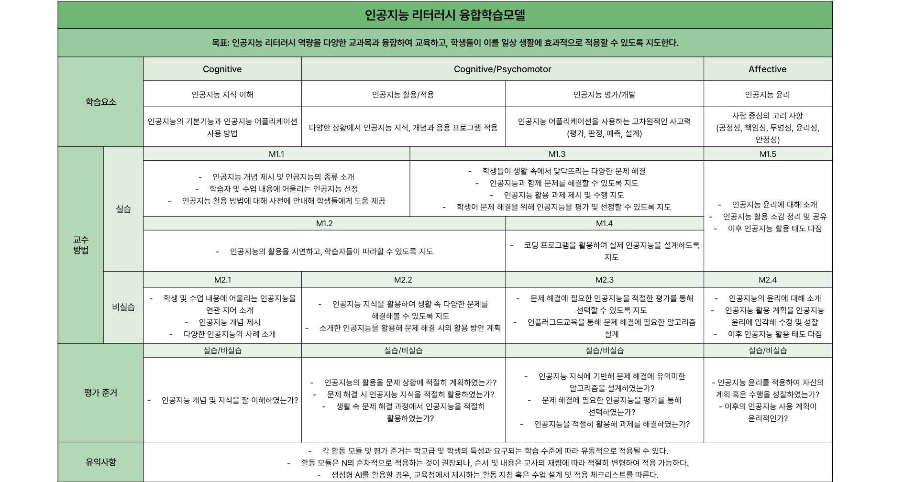

# K-12 대상 인공지능 융합학습모델 제안

**인공지능 리터러시 역량을 중심으로**

K-12 학생의 인공지능 리터러시를 교과 수업에 통합할 수 있도록 학습모델과 활동 모듈을 제안한 2024년 공동 연구입니다.

| 항목 | 내용 |
| --- | --- |
| 연도 | 2024 |
| 활동 맥락 | 제8회 인공지능인문학 대학생 학술논문 경연대회 관련 연구 |
| 공동저자 | 김효원 · 우승아 · 최은진 |
| 소속 | 이화여자대학교 교육공학과 |
| 우승아 역할 | 공동저자 · 논문 작성 |

## 연구 내용

인공지능의 지식·이해, 활용·적용, 평가·개발, 윤리 역량을 교육과정과 연결하고자 했습니다. 4C 역량, ARCS 동기설계, 블룸의 디지털 텍사노미를 참고하여 교사가 수업 설계에 활용할 수 있는 융합학습 활동 모듈을 제안했습니다.

이 연구는 학습모델 제안에 해당합니다. 원고에 기술된 한계와 같이 실제 학교 수업 적용을 통한 효과성 검증은 후속 과제입니다.

## 증빙 자료

- [논문 PDF — 16쪽](docs/paper.pdf)
- [융합학습 모듈 설계도](모듈설계.png)
- [블룸 분류체계 관련 도식](블룸표.png)

논문 본문은 ‘바탕화면 → 우승아 → 비교과 → 2024년 → 제8회 인공지능인문학 대학생 학술논문 경연대회’에 보관된 한글 파일의 본문·표·그림을 보존해 PDF로 변환했습니다. 공개본에서는 내부 공동편집 메모와 미갱신 목차를 제외했습니다. 원본 한글 파일은 로컬에 보존되어 있으며, 이 저장소는 연구 활동의 증빙용 아카이브입니다.
